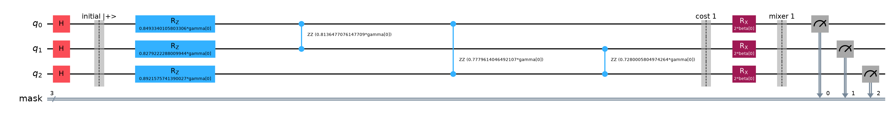

# Neural Network Pruning with Quantum Algorithms

**Shray Kumar** · [Demo](outputs/demo/Demo.ipynb) · [Code](outputs/demo/pruning.py) · [Experiments](outputs/archive/outputs/)

A smaller neural network, without losing what it learned. The challenge is choosing what to remove: with 100 binary inclusion decisions, there are $2^{100}$ possible masks.

### My approach

I reframed pruning as a function of **which weights are included**, represented by binary masks over neuron groups. For each mask, I restored the surviving weights to their original initialization, retrained the subnetwork, and measured validation loss.

I approximated that loss with a quadratic function:

```math
\widehat{L}(m) = c + \sum_{i} a_i m_i + \sum_{i<j} b_{ij} m_i m_j, \qquad m_i \in \{0,1\}.
```

Mapping $m_i=(1-Z_i)/2$ turns this function into a qubit Hamiltonian. QAOA alternates an **energy encoder**, which encodes predicted loss into phase, and a **mixer**, which explores candidate masks. A classical optimizer tunes the angles $\gamma$ and $\beta$. I then measure the circuit, select a mask, and retrain the pruned network.



<sub>Illustrative circuit. [Full hardware circuit](docs/figures/hardware-circuit.svg).</sub>

### What I achieved

The [16-qubit demo](outputs/demo/START_HERE.md) reduced **25,450 parameters to 12,730**, with test accuracy changing from **82.75% to 82.73%** on Fashion-MNIST.

In the [100-qubit IBM hardware experiment](outputs/archive/outputs/hw100_v6/RESULTS.md), QAOA beat random pruning in **two of three seeds** on best-of-10 validation loss. It did **not** outperform simulated annealing overall. This demonstrates quantum-guided pruning at a scale where exhaustive search is impractical; it does not establish an advantage over the best classical methods.

### Explore

Open the [notebook](outputs/demo/Demo.ipynb), or download the [HTML walkthrough](outputs/demo/Demo.html). The demo uses recorded hardware results; live CPU retraining is optional. All experiment code, comparisons, and hardware records are in the [archive](outputs/archive/).
