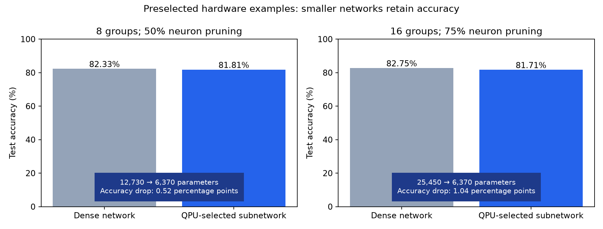
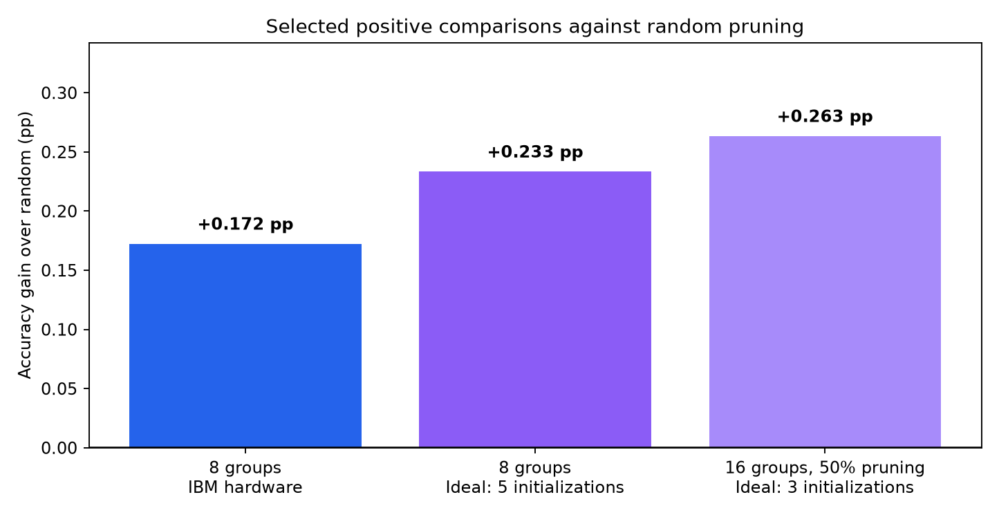

# Qismet — positive findings and implications

> **Qismet identifies high-performing subnetworks using far fewer retraining evaluations than exhaustive search, and improved selection accuracy over uniform random pruning in an eight-group IBM hardware demonstration.**

This section highlights positive observations from the saved experiments. Each result retains its setting and metric. It complements the separate report on limitations; it is not a pooled claim that every run improved. No retraining or IBM submission was performed to prepare this review.

## 1. Real hardware found compact subnetworks with strong accuracy retention

| Hardware example | Dense → pruned parameters | Dense → pruned test accuracy | Accuracy drop |
|---|---:|---:|---:|
| 8 groups; 50% neuron pruning | 12,730 → 6,370 | 82.33% → 81.81% | 0.52 pp |
| 16 groups; 75% neuron pruning | 25,450 → 6,370 | 82.75% → 81.71% | 1.04 pp |

Both masks were selected before their final test evaluation. Surviving weights were restored to the original random initialization and retrained with the same 20-epoch budget. These are individual, preselected hardware examples rather than averages over all masks.

**Implication:** the end-to-end process can turn a measured quantum bitstring into a physically smaller, useful classifier. The 16-group example uses approximately **four times fewer parameters** while remaining within **1.04 percentage points** of the dense model. The eight-group example uses approximately **half the parameters**, within **0.52 points**.

## 2. The eight-group hardware demonstration improved on random picking

| Execution and setting | Qismet | Random baseline | Improvement |
|---|---:|---:|---:|
| Real IBM hardware, 8 groups | 81.651% | 81.478% | +0.172 pp |
| Ideal simulation, 8 groups | 81.389% | 81.155% | +0.233 pp |
| Ideal simulation, 16 groups, 50% pruning | 82.863% | 82.600% | +0.263 pp |

For the eight-group hardware row, the metric is expected accuracy after choosing the lowest-QUBO-cost mask from 32 raw proposals. Invalid quantum outcomes consume the budget. The expectation is estimated from one actual 4,096-shot measurement batch and the measured retrained performance of its candidate masks. Circuit depth was chosen by QUBO score before test evaluation. A finite-shot bootstrap that repeats depth selection gives a sampling-only 95% interval of **[0.140, 0.202] pp** for the gain. This interval does not include device drift or dataset uncertainty.

The eight-group ideal row averages expected best-of-32 accuracy over five fresh initializations; **all five gains were positive**. The 16-group ideal row is the selected-network average for the specified 50% pruning setting over three initializations. Simulation and physical hardware results are deliberately labeled separately.

**Implication:** the learned cost and quantum proposal distribution can guide selection toward useful subnetworks rather than relying only on uninformed random selection. The hardware evidence supports this specific eight-group demonstration.

## 3. Qismet used a small fraction of exhaustive retraining's candidate evaluations

| Hidden-neuron pruning | All possible masks | Observed Qismet training runs | Share of full candidate count | Full pipeline wall time | QPU usage within that time |
|---|---:|---:|---:|---:|---:|
| 50% | 12,870 | 193 | 1.50% | 159.0 s | 3 s |
| 75% | 1,820 | 193 | 10.60% | 151.6 s | 3 s |

The observed production runs used **192 subnetworks to fit the loss model plus one final selected-network retraining**. The table compares that count with the number of candidates a full exhaustive-retraining procedure would evaluate. For 50% pruning, Qismet used about **1.5% of the full candidate count**—approximately **67 times fewer network-training evaluations**. At 75%, it used about **10.6%**, approximately **9.4 times fewer**.

The wall times above are measured cold replays: fresh fit-label training, regression, CPU simulation-based angle optimization, real IBM connection and circuit preparation, queueing, measurement processing, and final selected-network retraining/testing. Common data/model loading and feasible-mask feature preparation are outside the timed interval, as are earlier research and audit runs. These timed replays are separate from the illustrative 32-shot masks above.

**Implication:** representing retraining performance with a learned objective can substantially reduce how often the neural network must be trained during pruning. This is an evaluation-budget advantage over exhaustive retraining. The budget comparison does not assert equal global-optimum guarantees or a universal runtime speedup; the benefit of learning the surrogate is not attributed exclusively to quantum hardware.

## 4. The retraining-loss approximation captured useful structure

On the 16-group study, with 192 fit masks and 64 disjoint audit masks per case, mean held-out R² across three initializations was **0.591** at 50% pruning and **0.625** at 75%. Mean absolute validation-loss errors were **0.0054** and **0.0221**, respectively.

In the eight-group follow-up, the mean held-out R² across five fresh initializations was **0.450**, with mean absolute loss error **0.0132**. Ideal QAOA assigned an average **53.52%** probability to the best-scoring 10% of masks, compared with 10% under uniform sampling.

**Implication:** the approach has an empirically useful link between measured retrainability, a quadratic objective and quantum sampling. It is a working bridge between machine-learning experiments and quantum optimization.

## Presentation-ready wording

“We implemented an end-to-end pruning pipeline that learns a quadratic approximation of retraining performance and uses QAOA on IBM quantum hardware to propose subnetworks. Preselected hardware examples retained strong accuracy with roughly 50–75% fewer parameters. In our eight-group hardware demonstration, the quantum-assisted sampler improved expected best-of-32 accuracy over uniform random selection. In the 16-group timed pipeline, only 192 fit subnetworks and one final retraining were needed, compared with 12,870 candidates in exhaustive retraining.”

Use **‘more retraining-evaluation-efficient than exhaustive retraining’** for the efficiency statement, and **‘better than random in the eight-group hardware demonstration’** for the selection statement. ‘The globally best true subnetwork’ and ‘universal quantum speedup’ are not claims made by this positive section.

## Traceable saved evidence

- [Eight-group hardware comparison](constrained_v4/hardware/depth_comparison.csv), [selected result](constrained_v4/hardware/summary.json), [finite-shot uncertainty](constrained_v4/hardware/finite_shot_uncertainty.json).
- [Five fresh ideal initializations](constrained_v4/fresh_seed_summary.csv).
- [16-group hardware compression example](scale16_v5/hardware/keep_4/summary.json), [dense reference](scale16_v5/seed_1001/dense.json).
- [16-group local comparison](scale16_v5/all_comparisons.csv), [held-out surrogate audits](scale16_v5/all_surrogate_audits.csv).
- [Timed 50% pipeline](scale16_v5/end_to_end/quantum_keep_8/complete.json), [timed 75% pipeline](scale16_v5/end_to_end/quantum_keep_4/complete.json).
- [Completed IBM job inventory](positive_findings/completed_ibm_jobs.csv), [positive comparison metrics](positive_findings/positive_random_comparisons.csv), [evaluation budgets](positive_findings/evaluation_budget_and_pipeline_times.csv).

Review note: the saved exhaustive-retraining timing contains a shared long host interruption. That timing ratio is not used in this positive section. The original records are preserved, with the timing-quality review in `positive_findings/timing_quality_review.json`.
