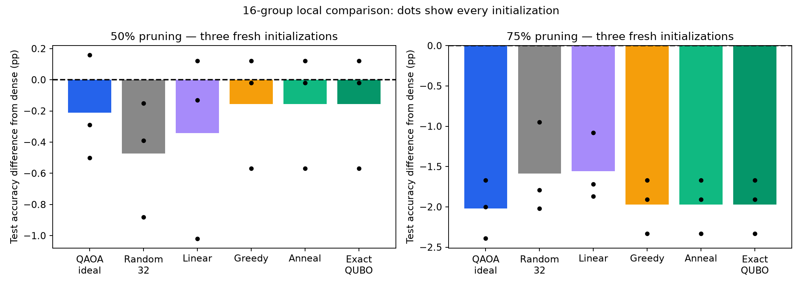
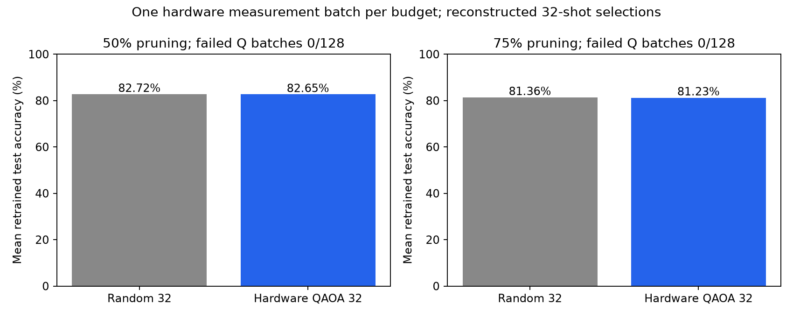

# Qismet: 16-group scaling experiment

This scaling run did not establish a quantum speed advantage. Greedy swaps and simulated annealing found an exact QUBO optimum in all six cases.

## What ran

Fashion-MNIST, the existing 5,000 training/1,000 validation/10,000 test split; fully connected network **784→32→10**. There are **16 groups of two neurons** and **16 logical qubits**. Three fresh initializations: 1001, 2002, 3003. The training budget is 20 epochs per mask, unchanged from the smaller experiment.

At 50% pruning, retain eight groups (16 neurons): **12,870** masks and **12,730 parameters**, versus **25,450** dense. At 75%, retain four groups (eight neurons): **1,820** masks and **6,370 parameters**.

For each initialization and pruning budget, 192 distinct masks fit the surrogate and 64 disjoint masks audit it. Total **1,536 retraining labels**. Linear, full-quadratic and ring-quadratic surrogates are audited; the full quadratic is the predeclared primary objective. Ridge regularization uses only cross-validation on the fit masks. All QAOA and classical selections are frozen before their final test evaluation.

## Local comparisons

QAOA here means an **ideal subspace simulation**, independently checked against the actual Qiskit circuit on the hardware initialization. One and two layers, three fixed optimizer starts per depth, then depth selection by predicted mean QUBO cost. It uses a number-preserving ring XY mixer and an initial state containing exactly the required number of retained groups.

| Method | 50% pruning: mean test accuracy | 75% pruning: mean test accuracy |
|---|---:|---:|
| QAOA best32 | 82.86% | 81.05% |
| Random best32 | 82.60% | 81.49% |
| Exact linear | 82.73% | 81.52% |
| Greedy swaps | 82.92% | 81.10% |
| Simulated annealing | 82.92% | 81.10% |
| Exact QUBO | 82.92% | 81.10% |

These are actual selected-network test accuracies, averaged over three initializations. One frozen 32-candidate draw per method per initialization is used, so differences include sampling variation. They are not the expected-distribution metrics reported in the earlier eight-group experiment. All individual cases remain in `all_comparisons.csv`.

## Approximation quality

The full quadratic's mean held-out R² is **0.591** at 50% pruning and **0.625** at 75%. Mean absolute validation-loss error is **0.0054** and **0.0221**. Linear and sparse-ring alternatives are reported in `all_surrogate_audits.csv`. A better QUBO minimum does not guarantee better true retraining performance, because this remains an approximation.

## Real 16-qubit hardware results

Four jobs ran on **ibm_fez**: an initial-state control and one-layer QAOA at each pruning budget, using 4,096 shots each. Reported QPU usage for this follow-up totals **12 seconds**; completed-job reported usage across the project is **44 seconds**. Prior uncertain usage remains reserved separately. Two-layer circuits were simulated but were not submitted as extra hardware jobs.

| Pruning | Q valid shots | Mean Q accuracy, successful batches | Mean random accuracy | Failed Q batches |
|---|---:|---:|---:|---:|
| 50% | 28.5% | 82.65% | 82.72% | 0/128 |
| 75% | 25.1% | 81.23% | 81.36% | 0/128 |

The aggregate hardware counts were shuffled with a fixed seed and partitioned into **128 reconstructed 32-shot selections**. Each quantum selection chooses its best feasible mask by QUBO score; each random selection has 32 feasible candidates scored by the same QUBO. All winning states were frozen before their networks were retrained and tested. These are partitions of **one measurement pool**, not 128 independent quantum jobs. No device-repeat confidence interval is claimed.

Invalid quantum outcomes consume the fixed 32-shot budget. Failed batches are reported explicitly. The successful-batch accuracy in the table excludes failed batches; `hardware/keep_*/summary.json` also reports the utility when an unusable batch receives zero. The initial-state controls and every raw outcome are retained.

## Search times and total work

| Classical search | 50% pruning: median seconds | 75% pruning: median seconds |
|---|---:|---:|
| Greedy swaps | 0.003804 | 0.002922 |
| Simulated annealing | 0.021901 | 0.021635 |
| Exact QUBO, enumerate and score | 0.049465 | 0.006640 |

These direct classical baselines score proposed masks from coefficients; greedy and annealing do not access a precomputed exhaustive score table. The primary local simulation uses an exhaustive energy table for state evolution; its earlier cached-table baseline timings are retained in per-run metadata but are not used in the table above.

Classical exact timings include enumeration and feature construction, score evaluation and argmin. They are measured implementations, not lower bounds on optimized classical performance. QPU-reported usage is a different clock from CPU elapsed time. Each hardware job's queue-inclusive observed time is in the ledger. `all_qaoa_optimization.csv` records simulator angle-optimization time and evaluations. `preparation_times.csv` records label training and regression, including audit/ablation work. All solvers share access to the learned surrogate.

Increasing the search space did not force classical methods to enumerate every candidate: local heuristics can exploit the QUBO structure. This study therefore does not establish quantum advantage or an end-to-end speedup. The meaningful outcomes are the measured pruning quality, approximation quality, solver gaps and hardware acceptance at the larger size.

## Code and evidence

- `experiment.py`: neural network, initialization rewind, fit/audit labels, surrogate fitting, ideal QAOA, classical comparisons.
- `hardware.py`: actual 16-qubit circuit, independent equivalence checks, IBM submissions and inherited usage accounting.
- `direct_classical.py`: direct-coefficient greedy, annealing and exact-search timings.
- `evaluate_hardware.py`: frozen 32-shot comparisons and final network evaluation.
- `hardware/ledger.json`: actual job IDs, device, counts paths, usage and elapsed-time evidence.
