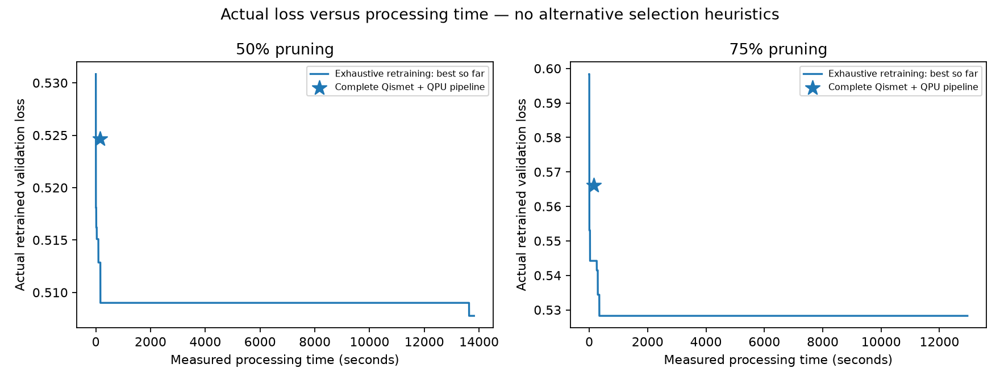

# Qismet + QPU versus exhaustive retraining

**Status: Partial results — unfinished runs are explicitly marked.** This focused presentation compares quantum-assisted pruning with exhaustive search. It distinguishes exhaustive neural-network retraining from exhaustive evaluation of an already fitted QUBO. It does not benchmark other selection heuristics.

## The expensive objective

For each mask, the true experimental objective is

$$g(m)=L_{validation}(Train(W_0,m)).$$

Exhaustive retraining evaluates this function for **every valid mask**, with the same original initialization, 20 epochs, data, optimizer and minibatch order. Qismet estimates it from **192 retraining examples**, fits a quadratic approximation and uses QAOA to propose a mask. These methods can have different costs and different solution quality.

The model is Fashion-MNIST **784→32→10**, with 16 groups of two hidden neurons. Seed 1001 is fixed for this comparison. Each case uses one CPU thread for its classical training work. Cases may run concurrently on separate CPU threads. Data loading and common mask/feature design are outside the timed intervals; quantum wall time additionally includes its actual IBM connection, circuit preparation, queueing and final retraining.

## Measured end-to-end comparison

| Pruning | Valid masks | Exhaustive retraining time/status | Qismet + QPU time/status | Exhaustive minimum actual loss | Quantum mask actual loss |
|---|---:|---|---|---:|---:|
| 50% | 12,870 | INCOMPLETE: 3,168/12,870 masks | 159.0 s | Global minimum not known yet | 0.524627 |
| 75% | 1,820 | 12961.0 s | 151.6 s | 0.528273 | 0.566111 |

The exhaustive curves use cumulative measured per-mask training/validation time; final benchmark totals also include checkpoint/selection and final winner evaluation. They are not QUBO predictions. Partial curves are not a certificate of the global optimum.

### 50% pruning

The fixed enumeration order had already reached a validation loss at least as low as the quantum result after approximately **1.6 seconds of per-mask retraining work** (3 masks). This is a time-to-match-quality observation; the full run is still needed to certify its global minimum.

The enumerator has processed **3,168/12,870** masks in **13818.1 active seconds**. Its estimated remaining time is **705.3 minutes**. This is a changing estimate, not a completed benchmark.

The timed quantum pipeline generated 192 fresh retraining labels, fitted the QUBO, optimized its angles on a CPU simulator, submitted an actual 16-qubit circuit, selected from 4,096 measured outcomes and retrained its final mask. Total measured wall time: **159.0 s**; QPU-reported usage alone: **3 s**. Actual test accuracy: **82.73%**.

### 75% pruning

The fixed enumeration order had already reached a validation loss at least as low as the quantum result after approximately **3.7 seconds of per-mask retraining work** (7 masks). This is a time-to-match-quality observation; the full run is still needed to certify its global minimum.

The timed quantum pipeline generated 192 fresh retraining labels, fitted the QUBO, optimized its angles on a CPU simulator, submitted an actual 16-qubit circuit, selected from 4,096 measured outcomes and retrained its final mask. Total measured wall time: **151.6 s**; QPU-reported usage alone: **3 s**. Actual test accuracy: **81.08%**.

Exhaustive retraining took **85.49 times** the measured quantum-pipeline wall time. The quantum mask's actual validation-loss gap to the exhaustive minimum is **0.037838**. A nonzero quality gap means this runtime ratio is a time/quality tradeoff, not a demonstrated speedup for finding the same optimum. The exhaustive winner's final test accuracy is **82.09%**.

## Why the earlier exhaustive baseline was fast

The earlier baseline enumerated the **quadratic formula**, not the neural-network retraining objective. A learned QUBO score has only 136 nonconstant terms. Evaluating those terms for thousands of masks is much cheaper than training thousands of networks.

| Pruning | Exhaustive QUBO scoring, CPU elapsed | Prior hardware batch | Exact QUBO optimum observed on hardware |
|---|---:|---:|---:|
| 50% | 49.47 ms | 3 s QPU usage | 1/4,096 |
| 75% | 6.64 ms | 3 s QPU usage | 2/4,096 |

The full prior quantum batches did contain an exact QUBO optimum in both cases. That certifies a successful observed solution of the **approximation** on those instances. It does not establish that the corresponding network minimizes actual retraining loss. The separate timed replay above reports its own outcomes.

## What can be claimed

This experiment can measure whether a learned surrogate plus quantum sampling returns a useful subnetwork in less time than retraining every candidate, and quantify the actual loss gap to exhaustive retraining. A finite-depth QAOA run does not guarantee the global minimum. A QUBO approximation does not guarantee preservation of the true objective's minimizer.

A runtime win against exhaustive retraining, at a stated quality level, would support this **particular pipeline and baseline**. It would not prove universal quantum acceleration for arbitrary optimization problems, nor isolate how much of the benefit comes specifically from the quantum component versus learning the surrogate.

## Reproduce and inspect

- `exhaustive_retraining.py --keep 4` or `--keep 8`: actual exhaustive oracle, with resumable checkpoints.
- `timed_quantum_pipeline.py`: fresh timed pipeline, including real hardware and all 192 fit retrains; no audit-retraining cost is included in the production pipeline.
- `exhaustive_retraining/keep_*/progress.json`: live exhaustive progress and measured times.
- `end_to_end/quantum_keep_*/complete.json`: complete measured pipeline timings and actual loss.
- The earlier full benchmark is preserved as `Full_Benchmark.html`; raw results are unchanged.
